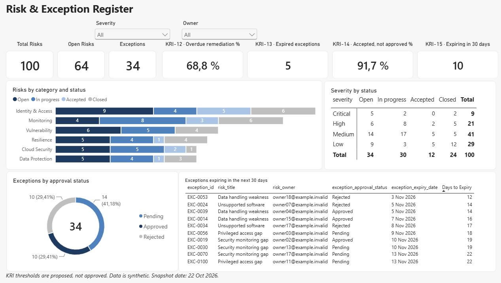
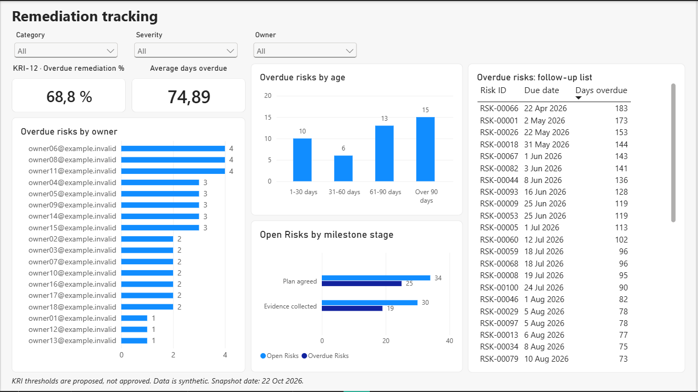
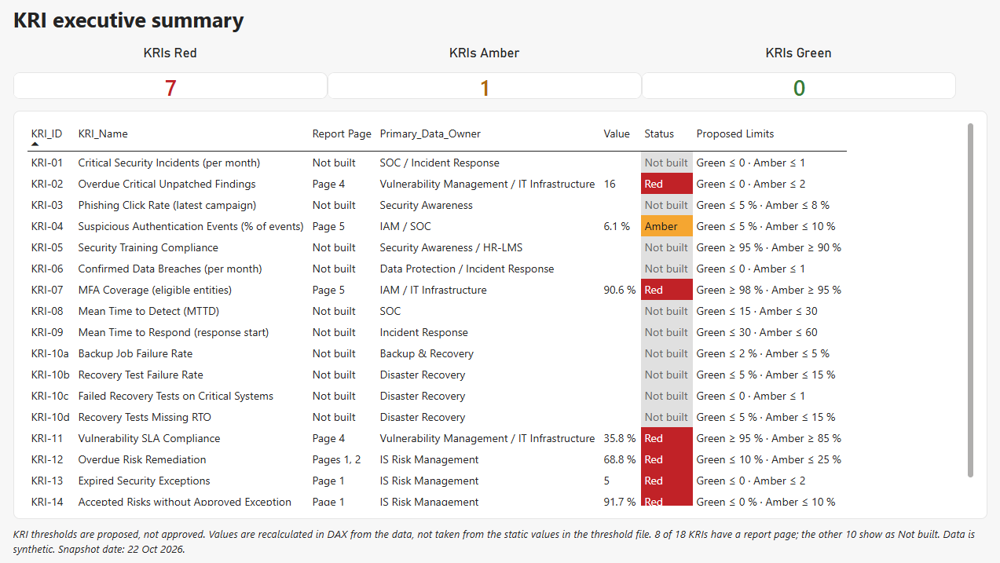
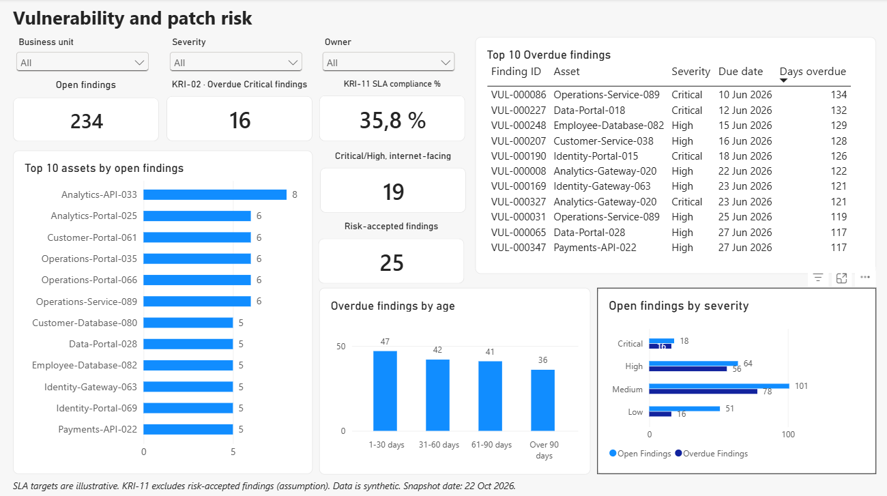
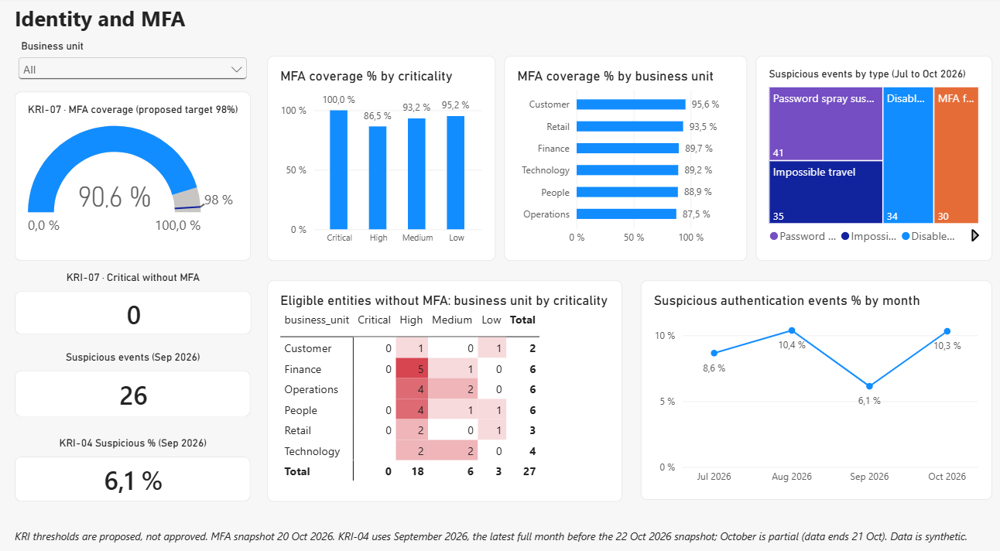

# InfoSec risk and KRI reporting: financial sector case study

A self-initiated learning project, not work experience. I built a Power BI risk report for a
fictional bank, then read it like a risk analyst: what is wrong, why it matters, and what I would
recommend. All data is synthetic. Snapshot date: 22 Oct 2026. KRI thresholds are proposed, not approved.

**Scope:** five report pages are built (1 to 5). The other pages were left out on purpose. Five pages checked against the raw data seemed more useful than nine rushed ones.

**Start here:** [findings/management-summary.md](findings/management-summary.md), the 5 risks I would raise first, each with a number, a recommended action and a suggested owner.

## What I found (Page 1: risk and exception register)

- 44 of 64 open risks (68.8%) are past their remediation due date.
- 11 of 12 accepted risks have no approved exception.
- 5 exceptions have already expired, and 10 more expire within 30 days. 3 of the 5 were never decided.
- None of the 34 exceptions records an approver, so no approval can be audited.

## What I found (Page 2: remediation tracking)

- The 44 overdue risks are 75 days late on average. 28 are more than 60 days late, and 15 are more than 90 days late.
- All 18 risk owners have at least one overdue risk. No owner has more than 4.
- None of the 64 open risks has reached the Remediated milestone.

## What I found (Page 3: KRI executive summary)

- 8 of the 18 KRIs have a report page. Under the proposed limits, 7 are Red, 1 is Amber (KRI-04) and none is Green.
- The 10 KRIs without a page (incidents, breaches, phishing, training, backup and recovery) are shown as Not built and are not rated.
- Seven Reds may also mean the proposed limits are strict. They need a risk-appetite decision before anyone escalates on them.
- Every value on this page comes from the measures behind Pages 1, 2, 4 and 5. The static values in the threshold file are not used.

## What I found (Page 4: vulnerability and patch risk)

- 166 of 234 open findings (70.9%) are past their due date. 16 of them are Critical, and 36 are more than 90 days late.
- Vulnerability SLA compliance (KRI-11) is 35.8% (120 of 335). The proposed green limit is 95%.
- Only 3 of the 25 risk-accepted findings have an approved exception that has not expired.
- 19 open Critical and High findings sit on internet-facing production assets.

## What I found (Page 5: identity and MFA)

- MFA coverage (KRI-07) is 90.6% (261 of 288 eligible entities). The proposed green limit is 98%.
- 27 eligible entities have no MFA: 18 High, 6 Medium, 3 Low. None is Critical.
- No Critical entity is without MFA only because three Critical system accounts are marked not eligible, and the file gives no reason.
- Coverage is lowest in Operations (87.5%) and highest in Customer (95.6%).
- Suspicious authentication events (KRI-04) were 6.1% in September 2026 (26 of 424), after 8.6% in July and 10.4% in August. What counts as suspicious is my assumption.

Each number can be recounted from the raw files. The steps are in [method/kpi-definitions.md](method/kpi-definitions.md).

## Where to look

| Folder | What you will find |
|---|---|
| [findings](findings) | A risk assessment of 6 risks, and a log of data problems with counts |
| [method](method) | How the data model is built and how each KPI is calculated |
| [data](data) | The 18 source files, grouped, with row counts and known issues |
| [screenshots](screenshots) | Model view and report page screenshots |
| [report](report) | PDF export of the five report pages |

If you have two minutes: read [findings/management-summary.md](findings/management-summary.md). For the judgment behind it, read [findings/risk-assessment.md](findings/risk-assessment.md).

## Progress

| Page | Status |
|---|---|
| 1 Risk and exception register | done |
| 2 Remediation tracking | done |
| 3 KRI executive summary | done |
| 4 Vulnerability and patch risk | done |
| 5 Identity and MFA | done |
| 6 to 9: resilience, incidents and breaches, human risk, AI risk and controls | not built |

## Limits

- The data is synthetic and made up. Findings describe this dataset, not a real company.
- The main risk register has only a severity. Likelihood, impact, threats and treatments in the risk assessment are my assumptions, and they are labelled.
- Regulation references (DORA, ISO 27001, NIST CSF) in `control_mapping.csv` are drafts and need Compliance review.
- Several fields in the exception file are empty ("TO FILL"). I report this as a finding and did not fill them in.
- The milestone column in the risk register repeats the status column (Open = Plan agreed, In progress = Evidence collected). It is not an independent progress measure.
- KRI-11 leaves risk-accepted findings out. That is my assumption, because the rulebook does not say. The SLA targets are illustrative.
- KRI-04 counts four authentication event classifications as suspicious. That definition is my assumption and is not confirmed with policy. The directory has no termination date, so events from Terminated and Leave accounts are not reported as findings.
- The recommended actions and suggested owners in the management summary are my judgment, not facts from the data. The data names no owner for them.
- Under the proposed limits, 7 of the 8 rated KRIs are Red. The limits are not approved and may be strict, so the colours show direction, not an approved judgment.
  
## Tools

Power BI (data model, DAX measures, report), Power Query (cleaning), Excel and CSV for checking numbers.
