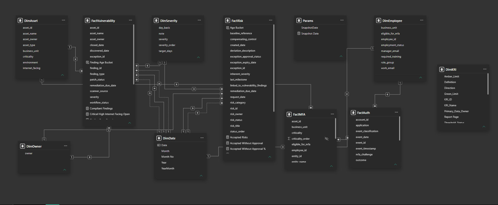

# Screenshots

Screenshots of the Power BI report and its data model. All data is synthetic. KRI thresholds are proposed, not approved. Snapshot date: 22 Oct 2026.

| File | Page | What it shows | Status |
|---|---|---|---|
| [00-model-view.png](00-model-view.png) | Model | Star schema, phase 1 | Done |
| [01-risk-exception-register.png](01-risk-exception-register.png) | 1 Risk and exception register | Risks, exceptions, KRI-12 to KRI-15 | Done |
| 02-remediation-tracking.png | 2 Remediation tracking | | In progress |
| 03 to 09 | Pages 3 to 9 | | Planned |

## 00 Model view

- Facts in the centre: FactRisk, FactVulnerability.
- Dimensions around them: DimAsset, DimOwner, DimSeverity, DimDate.
- Params is a one-row helper table holding the snapshot date. It has no relationships.
- Relationships are one-to-many, single direction, from dimension to fact. Fact tables are not connected to each other.
- Dotted lines are inactive relationships (DimDate links to several date columns, only one is active per fact).
- Known gap: the risk register has no asset ID, so FactRisk is not linked to DimAsset.
- More facts are added in later pages. See [method/data-model.md](../method/data-model.md).

## 01 Risk and exception register

- 100 risks, 64 open (Open + In progress), 34 with an exception.
- KRI-12 Overdue risk remediation: 68.8% (44 of 64).
- KRI-13 Expired security exceptions: 5.
- KRI-14 Accepted risks without approved exception: 91.7% (11 of 12).
- KRI-15 Exceptions expiring within 30 days: 10.
- Definitions and formulas: [method/kpi-definitions.md](../method/kpi-definitions.md).
- Owner addresses are synthetic placeholders (example.invalid).
