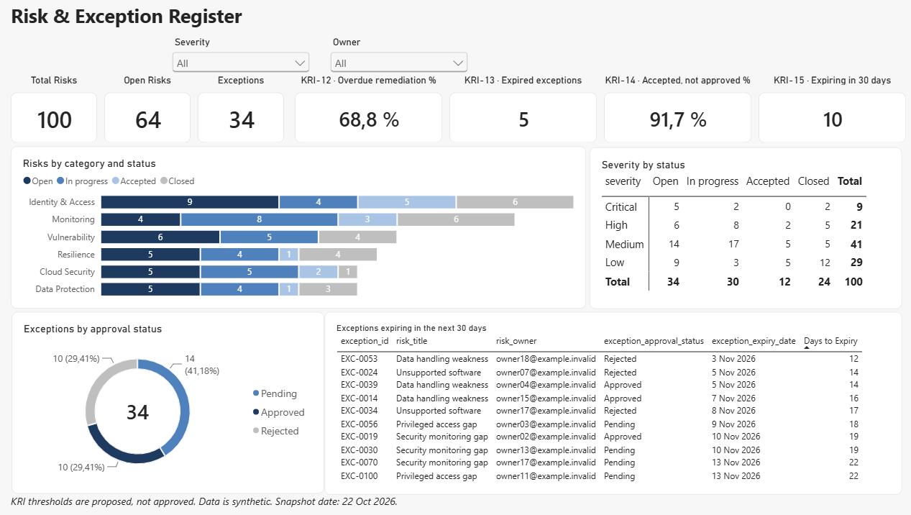
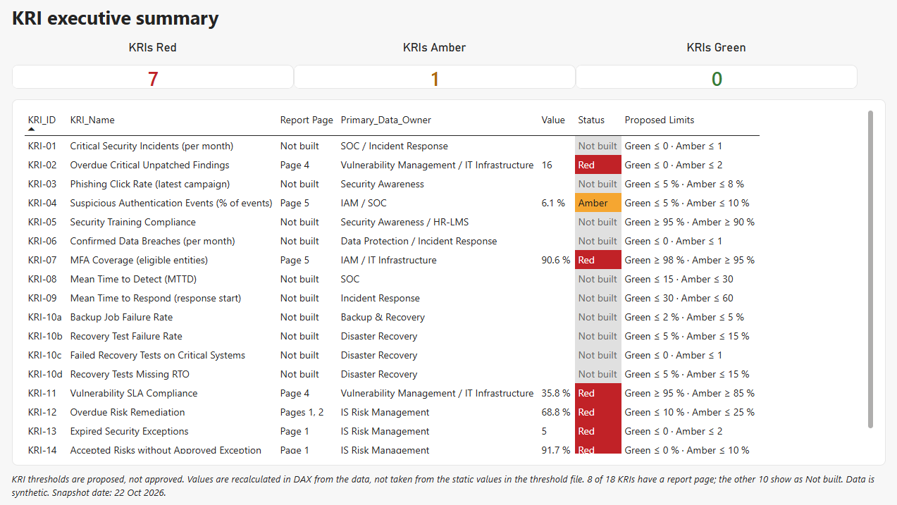

# Screenshots

The images behind the report: the data model, then one screenshot per page. This file says what to look at in each one. The results of each page are in [report/README.md](../report/README.md), and the definitions behind every number are in [method/kpi-definitions.md](../method/kpi-definitions.md).

## Model view (`00-model-view.png`)

- The shape is the point: four fact tables in the centre, with FactRisk, FactVulnerability, FactMFA and FactAuth never connected to each other, and the dimensions around them filtering in one direction.
- Params and DimKRI sit apart on purpose. They hold the snapshot date and the KRI limits, and the measures read them directly, so they need no relationships.
- The dotted lines are inactive relationships: DimDate links to several date columns, and only one is active per fact. Two design choices are explained in [data-model.md](../method/data-model.md): why FactMFA has two nullable keys, and why FactRisk is not linked to DimAsset.

## Page 1: Risk and exception register (`01-risk-exception-register.png`)

- The page pairs one remediation KRI with three exception KRIs, because both are about whether risk decisions are followed through.
- The finding is that most open risks are late, and that nearly every accepted risk lacks an approved exception. Most of the exceptions that are about to expire are not approved either.

## Page 2: Remediation tracking (`02-remediation-tracking.png`)

- This page explains the overdue figure on Page 1. The three breakdowns show the lateness is widespread, not local: every one of the 18 owners has at least one overdue risk, most overdue risks are more than 60 days late, and no open risk has got past the first two milestones.

## Page 3: KRI executive summary (`03-kri-executive-summary.png`)

- The finding is that nearly every KRI that can be calculated is Red. Three things on the page are not visible in the image.
- KRI-07 turns Red automatically if any Critical eligible entity has no MFA, whatever the percentage.
- Every value comes from the same measures as the page it belongs to, so the numbers match across pages.
- The Not built rows are the areas I did not build.

## Page 4: Vulnerability and patch risk (`04-vulnerability-patch-risk.png`)

- The page shows a large overdue backlog and a low share of findings fixed on time, and the backlog is old, not recent.
- The internet-facing Critical and High findings are the group to fix first.
- Risk-accepted findings are left out of the open, overdue and SLA figures and shown on their own.

## Page 5: Identity and MFA (`05-identity-mfa.png`)

- The MFA gap sits in High-criticality accounts and in three business units, and most of the 27 accounts without MFA are human accounts (21), not system accounts (6).
- The Critical figure of zero depends on three Critical system accounts that the source file marks as not eligible without giving a reason.
- The gauge marks the proposed 98% target. On the authentication side, the suspicious rate changes from month to month, and October is partial, so it is not used for KRI-04.
- The business unit slicer applies to the MFA visuals only. The authentication visuals are not connected to it.
